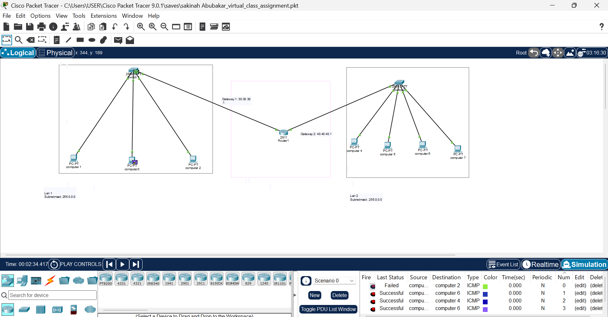

# tech4youth-two-Lan-network-packet-tracer

## Addressing
| Device | Interface | IP Address | Mask | Gateway |
|---|---|---|---|---|
| Router1 | Gig0/0 (to Switch 1, LAN 1) | 30.30.30.1 | 255.0.0.0 | 30.30.30.1 (Gateway 1) |
| Router1 | Gig0/1 (to Switch2, LAN 2) | 40.40.40.1 | 255.0.0.0 | 40.40.40.1 (Gateway 2) |
| Switch 1 | Layer 2, 2960-24TT | None | None | None |
| Switch2 | Layer 2, 2960-24TT | None | None | None |
| computer 1 | FastEthernet0 | 30.30.30.2| 255.0.0.0 | 30.30.30.1 |
| computer 2 | FastEthernet0 | 30.30.30.3 | 255.0.0.0 | 30.30.30.1 |
| computer3 | FastEthernet0 | 30.30.30.4 | 255.0.0.0 | 30.30.30.1 |
| computer 4 | FastEthernet0 | 40.40.40.2| 255.0.0.0 | 40.40.40.1 |
| computer 5 | FastEthernet0 | 40.40.40.3 | 255.0.0.0 | 40.40.40.1 |
| computer 6 | FastEthernet0 | 40.40.40.4 | 255.0.0.0 | 40.40.40.1 |
| computer 7 | FastEthernet0 | 40.40.40.5| 255.0.0.0 | 40.40.40.1 |

## Connections
| Switch | Connected devices |
|---|---|
| Switch 1 (LAN 1) | computer 1, computer 2, computer3, Router1 Gig0/0 |
| Switch2 (LAN 2) | computer 4, computer 5, computer 6, computer 7, Router1 Gig0/1 |
